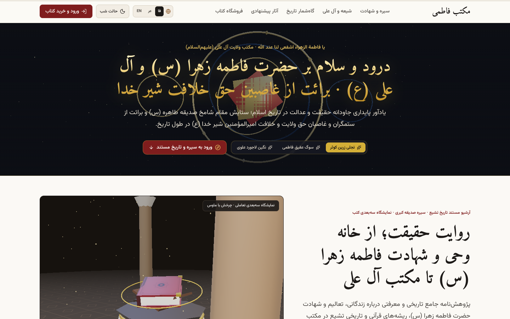
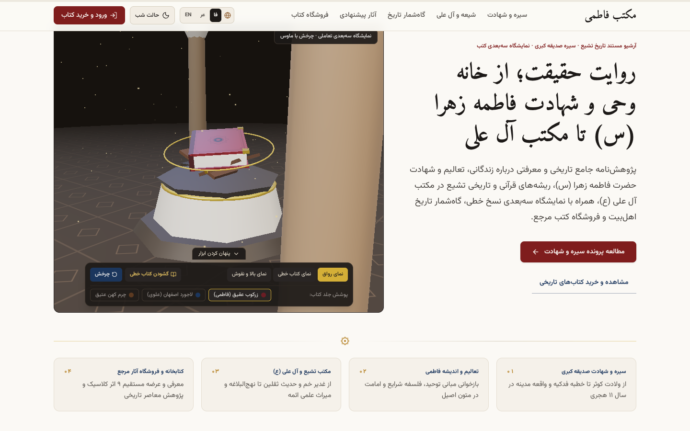
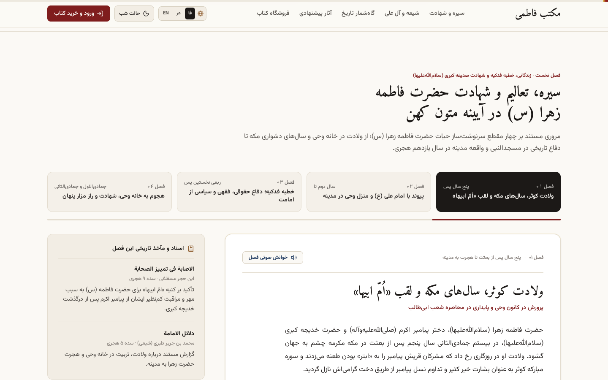
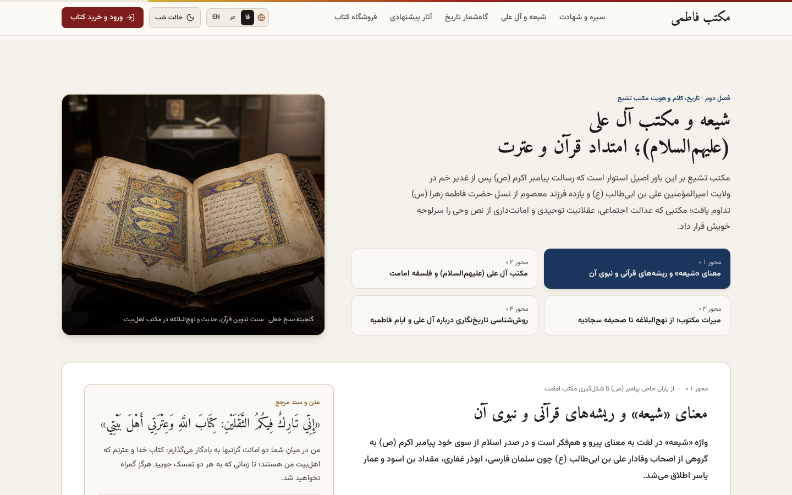
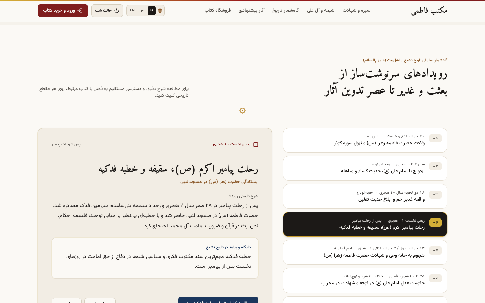
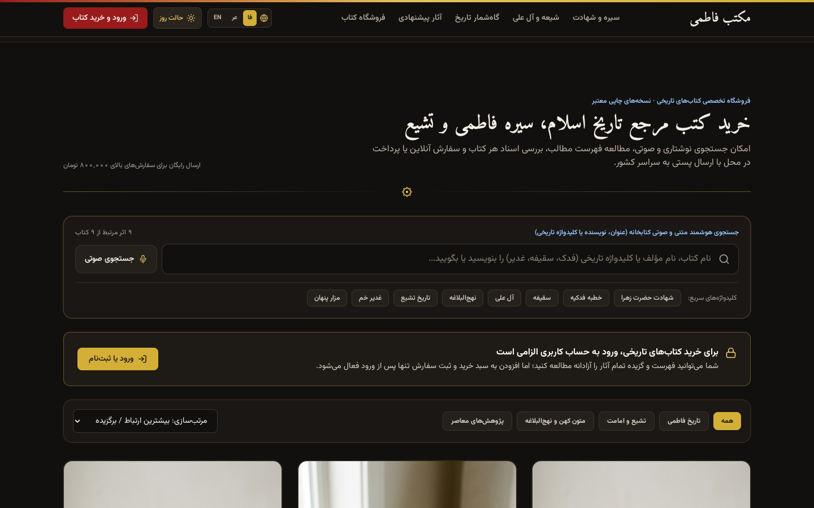
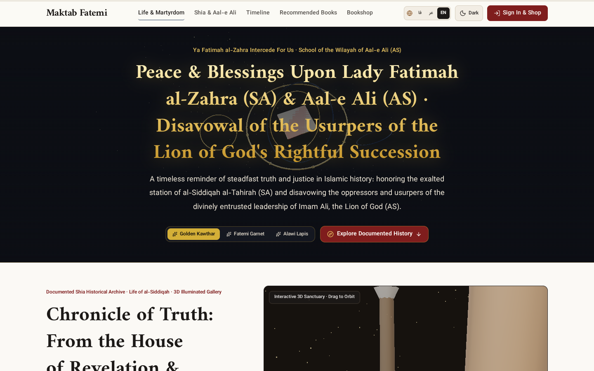
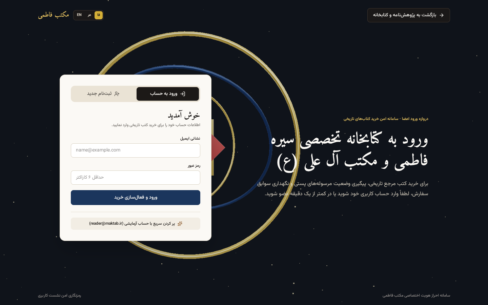
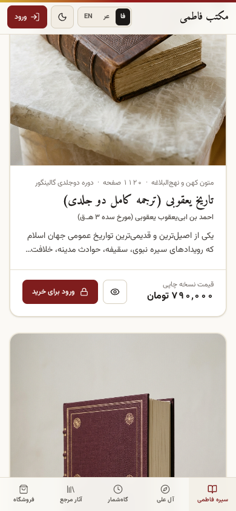

<div align="center">

# ✦ مکتب فاطمی | Maktab Fatemi ✦

### آرشیو مستند سیره و شهادت حضرت فاطمه زهرا (س)، تاریخ تشیع در مکتب آل علی (ع) و کتابخانه و فروشگاه سه‌بعدی کتب مرجع

[](https://amiralisite.github.io/maktab-fatemi/)
[](https://amiralisite.github.io/maktab-fatemi/)
[](https://threejs.org/)
[](https://react.dev/)

<p align="center">
  پژوهش‌نامه‌ای تعاملی، سه‌بعدی و تمام‌سه‌زبانه با طراحی الهام‌گرفته از تذهیب، نسخ خطی و معماری رواق‌های نورانی؛<br/>
  متمرکز بر زندگانی و شهادت صدیقه کبری (س)، خطبه فدکیه، ریشه‌های قرآنی تشیع و عرضه آثار مرجع تاریخی.
</p>

[**🚀 ورود به نسخه آنلاین (Live Site)**](https://amiralisite.github.io/maktab-fatemi/) · [**📖 مستندات و معماری**](#-ویژگی‌های-شاخص-پلتفرم) · [**🛠️ راه‌اندازی محلی**](#-نصب-و-اجرای-محلی)

<br/>



</div>

---

## ✨ درباره پروژه

**«مکتب فاطمی»** یک پایگاه پژوهشی و نمایشگاه سه‌بعدی در وب است که اسناد تاریخی سیره و شهادت حضرت فاطمه زهرا (سلام‌الله‌علیها)، مبانی معرفتی مکتب تشیع و آل علی (علیهم‌السلام) و فروشگاه تخصصی کتب مرجع تاریخ اسلام را در قالبی فاخر، مدرن و کاملاً تعاملی گرد هم آورده است.

این وب‌سایت هم با بک‌اند کامل (`Express` + نشست احراز هویت و سفارش) و هم به‌صورت **کاملاً استاتیک روی GitHub Pages** (با پشتیبانی خودکار ذخیره امن محلی برای ثبت‌نام، ورود و سبد خرید) کار می‌کند.

---

## 🖼️ نماهای واقعی وب‌سایت (Screenshots)

<table>
  <tr>
    <td width="50%" align="center">
      <strong>🏛️ رواق سه‌بعدی و نسخه خطی تعاملی (Three.js)</strong><br/><br/>
      <br/>
      <sub>کنترل زاویه دوربین، باز و بسته کردن کتاب خطی در صحنه WebGL و تغییر جلد (عقیق، لاجورد، چرم عتیق)</sub>
    </td>
    <td width="50%" align="center">
      <strong>📜 پرونده سیره، خطبه فدکیه و خوانش صوتی</strong><br/><br/>
      <br/>
      <sub>مطالعه فصل‌بندی‌شده با اسناد تاریخی فریقین، دکمه خوانش صوتی فصل و نوار پیشرفت مطالعه در بالای صفحه</sub>
    </td>
  </tr>
  <tr>
    <td width="50%" align="center">
      <strong>🕌 مکتب تشیع و گنجینه نسخ خطی</strong><br/><br/>
      <br/>
      <sub>بازخوانی ریشه‌های قرآنی تشیع، حدیث ثقلین، نهج‌البلاغه و روش‌شناسی تاریخ‌نگاری</sub>
    </td>
    <td width="50%" align="center">
      <strong>⏳ گاه‌شمار تعاملی تاریخ اهل‌بیت (ع)</strong><br/><br/>
      <br/>
      <sub>مرور ۸ مقطع سرنوشت‌ساز از ولادت کوثر و غدیر خم تا تدوین کتب اربعه و میراث علمی</sub>
    </td>
  </tr>
  <tr>
    <td width="50%" align="center">
      <strong>🌙 حالت مطالعه شب (Dark Mode) و جستجوی صوتی</strong><br/><br/>
      <br/>
      <sub>فروشگاه کتاب با فیلتر موضوعی، کلیدواژه‌های تاریخی سریع، جستجوی صوتی با میکروفون و تم شب آرام‌بخش</sub>
    </td>
    <td width="50%" align="center">
      <strong>🌐 پشتیبانی کامل سه‌زبانه (فارسی · عربی · انگلیسی)</strong><br/><br/>
      <br/>
      <sub>تغییر آنی زبان و جهت صفحه (RTL / LTR)، ترجمه کامل متون تاریخی، اعداد بومی‌سازی‌شده و عنوان صفحه</sub>
    </td>
  </tr>
  <tr>
    <td width="50%" align="center">
      <strong>🔐 دروازه ورود و ثبت‌نام سه‌بعدی (اسطرلاب دوّار)</strong><br/><br/>
      <br/>
      <sub>دروازه ورود اختصاصی قبل از خرید کتاب با پس‌زمینه سه‌بعدی WebGL، اسطرلاب طلایی و ورود سریع آزمایشی</sub>
    </td>
    <td width="50%" align="center">
      <strong>📱 طراحی واکنش‌گرا و منوی ثابت پایین در موبایل</strong><br/><br/>
      <br/>
      <sub>حذف منوی کشویی سنگین و جایگزینی با نوار دسترسی سریع پایین صفحه برای کاربری روان در موبایل</sub>
    </td>
  </tr>
</table>

---

## 🌟 ویژگی‌های شاخص پلتفرم

| قابلیت | توضیحات فنی و تجربه کاربری |
| :--- | :--- |
| **🎭 صحنه‌های سه‌بعدی WebGL** | سه محیط سه‌بعدی اختصاصی با `Three.js` شامل نشان سرصفحه با ۳ حال‌وهوای نوری (کوثر، عقیق، لاجورد)، رواق تعاملی با کتاب خطی گشودنی، و اسطرلاب دوّار در صفحه ورود |
| **🌍 سه‌زبانه تمام‌عیار (`FA / AR / EN`)** | پشتیبانی کامل از **فارسی (RTL)**، **عربی (RTL)** و **انگلیسی (LTR)** شامل ترجمه علمی تمام فصول، گاه‌شمار، معرفی کتب، اعداد بومی و متا تگ‌ها |
| **🎙️ جستجوی هوشمند و صوتی کتابخانه** | جستجو بر اساس عنوان، نویسنده یا کلیدواژه‌های تاریخی، هشتگ‌های سریع و جستجوی صوتی مستقیم با **Web Speech API** متناسب با زبان فعال |
| **🔊 خوانش صوتی فصول تاریخی** | امکان گوش‌دادن به متن هر فصل از سیره و شهادت با تنظیم خودکار گویش (`fa-IR` / `ar-SA` / `en-US`) |
| **🌙 حالت شب ویژه مطالعه متون** | تغییر تم فوری میان کاغذ نباتی روز و پس‌زمینه ذغالی-طلایی شب همراه با ذخیره ترجیح کاربر در `localStorage` |
| **📊 نوار پیشرفت مطالعه** | نوار زنده بالای صفحه که میزان پیشرفت اسکرول و مطالعه کاربر را در بخش‌های پژوهشی نمایش می‌دهد |
| **🛒 دروازه خرید و سبد سفارش** | مشاهده آزاد تمامی کتاب‌ها و فهرست مطالب، با الزام احراز هویت پیش از افزودن به سبد خرید و ثبت سفارش |
| **⚡ استقرار خودکار GitHub Pages** | مجهز به ورک‌فلو `GitHub Actions` و لایه fallback استاتیک برای عملکرد بدون خطا حتی بدون سرور Node.js |

---

## 🧱 پشته فناوری (Tech Stack)

- **هسته فرانت‌اند:** React 19, TypeScript, Vite 8
- **طراحی و تایپوگرافی:** Tailwind CSS v4, Vazirmatn, Amiri, Lucide Icons, Motion
- **گرافیک سه‌بعدی:** Three.js (`RoomEnvironment`, `BufferGeometry`, `WebGLRenderer`)
- **بک‌اند (حالت Full-Stack):** Node.js, Express (`server.ts`)
- **چندزبانگی:** سیستم i18n اختصاصی با مدیریت خودکار `dir` و `lang` و فونت‌بندی بومی
- **استقرار (CI/CD):** GitHub Actions → GitHub Pages (`vite build` با `VITE_BASE_PATH`)

---

## 📁 ساختار کلیدی پروژه

```text
maktab-fatemi/
├── .github/workflows/deploy.yml   # ورک‌فلو ساخت و انتشار خودکار در GitHub Pages
├── docs/screenshots/              # تصاویر واقعی گرفته شده از نماهای وب‌سایت
├── server.ts                      # سرور Express برای محیط توسعه و API احراز هویت/سفارش
├── index.html                     # نقطه ورود HTML و تنظیم اولیه تم و زبان
└── src/
    ├── i18n/                      # کانتکست زبان و واژه‌نامه سه‌زبانه (FA / AR / EN)
    ├── data/                      # داده‌های مستند تاریخی، گاه‌شمار، کتب و ترجمه‌ها
    ├── services/                  # سرویس احراز هویت و سفارش (با پشتیبانی استاتیک)
    └── components/                # ماژول‌های سه‌بعدی Three.js، فروشگاه، جستجو و ناوبری
```

---

## 🛠️ نصب و اجرای محلی

برای اجرای پروژه روی سیستم شخصی خود:

```bash
# ۱. کلون کردن مخزن
git clone https://github.com/amiraliSite/maktab-fatemi.git
cd maktab-fatemi

# ۲. نصب وابستگی‌ها
npm install --legacy-peer-deps

# ۳. اجرای محیط توسعه (فرانت‌اند + سرور Express روی پورت ۳۰۰۰)
npm run dev
```

سپس مرورگر را روی `http://localhost:3000` باز کنید.

### دستورات ساخت و بررسی

```bash
npm run lint    # بررسی خطاهای TypeScript
npm run build   # ساخت نسخه نهایی تولید در پوشه dist/
```

---

<div align="center">

**ساخته شده با احترام به میراث مکتب فاطمی و آل علی (علیهم‌السلام)**

[🌐 مشاهده آنلاین پروژه](https://amiralisite.github.io/maktab-fatemi/) · [📦 مخزن گیت‌هاب](https://github.com/amiraliSite/maktab-fatemi)

</div>
